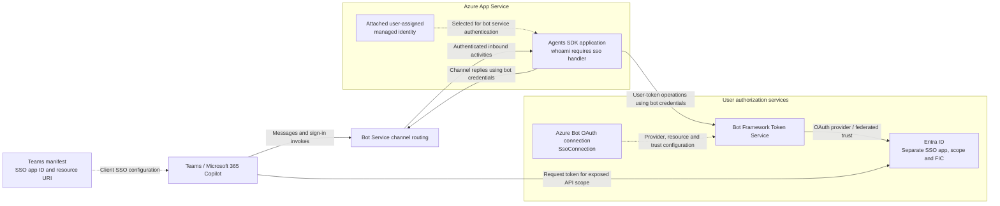
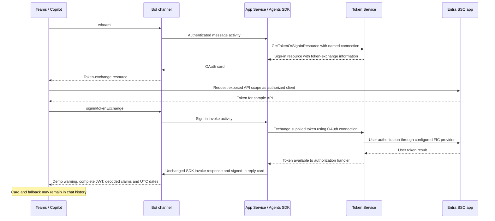
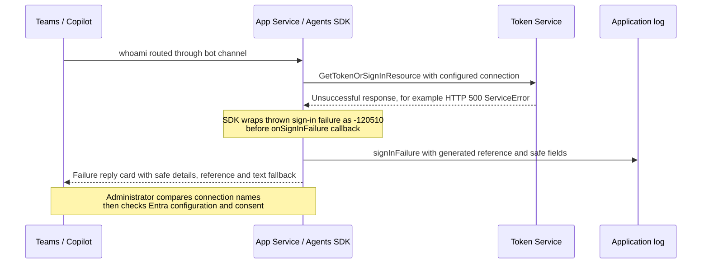

# Architecture and SSO flows

[Overview](../README.md) | [Configure](CONFIGURATION.md) | [Deploy](DEPLOYMENT.md) | [Troubleshoot](TEST-RESULTS.md)

The diagrams describe this sample's Azure public-cloud flow. They are conceptual, not a complete trace of every protocol request. Deployment values remain placeholders.

## 1. Separate bot authentication from user authorization

**Bot identity:** the attached managed identity is selected by SDK connection settings for outbound service authentication. It is not the user's account, and manifest configuration does not attach it to App Service. The SDK validates inbound activities separately; a wildcard outbound connection map does not bypass that validation.

**User identity:** the `sso` handler selects the Azure Bot OAuth connection. That connection refers to the separate Entra SSO app, requested resource/scope and federated trust. The user token is not the managed identity's token.

| Configuration owner | Responsibility | Exact alignment |
|---|---|---|
| App Service and SDK connection | Bot service identity and outbound routing | Managed-identity client ID = `<bot-id>` |
| Runtime `sso` handler | Select user authorization connection | Connection name = Azure Bot OAuth connection name |
| Azure Bot OAuth connection | Select SSO app, provider, scopes and token-exchange resource | Client ID = `<sso-app-id>` |
| Entra SSO app | Define exposed scope, pre-authorized clients, consent and FIC trust | Application ID URI = `api://botid-<bot-id>` |
| Teams manifest | Tell the host which SSO app/resource to request | `webApplicationInfo.id` = `<sso-app-id>`; resource = same URI |
| Teams package | Identify the installed app across updates | Root manifest ID = independent `<teams-app-id>` |

Use the [full ID mapping and configuration tables](CONFIGURATION.md#1-distinguish-the-three-identities) for portal fields and environment settings. The OAuth Token Exchange URL must also equal the same resource URI.

## 2. Successful whoami with no cached user token

Bot-to-channel and bot-to-Token-Service calls use **bot credentials**. Client acquisition and the OAuth exchange concern the **user's token**. The resource here is the sample's own API, not Microsoft Graph; downstream APIs need their own permissions and SDK OBO or separate connection configuration.

A cached user token can skip the card/exchange path. Consent, Conditional Access, tenant policy and host support can instead require interactive sign-in. `logout` clears the Token Service cache but does not sign the user out of Teams or revoke Entra consent.

The demo disclosure boundary is intentional: the authorized `whoami` reply contains the complete credential and decoded payload by default, **not** a validated identity result. Only this runtime reply/fallback receives those values; source, publication packages, application flow markers and surfaced errors do not. Payload text is escaped, decoded locally and bounded before sending. `WHOAMI_TOKEN_DISPLAY=masked` restores metadata-only output; deleting the chat or signing out is not a guarantee of token revocation or retention removal.

## 3. Configuration-related token retrieval failure

The example status/code is illustrative. A generic `ServiceError` does **not** explicitly establish "connection not found"; compare configuration before diagnosing the cause. The message gives an investigation step, not a definitive provider diagnosis.

The handler intercepts known sign-in exceptions only on `whoami` message turns. It does not replace SDK handling for unrelated errors, other commands or invoke turns. Startup misconfiguration still fails startup. Both this path and the sign-in-failure callback omit arbitrary provider text, tokens, claims, URLs and stacks from the application response/log marker.

See [troubleshooting](TEST-RESULTS.md#token-retrieval-fails-before-the-sign-in-callback) for diagnostic scope and [deployment](DEPLOYMENT.md#5-updates-and-cleanup) to apply source changes. Publishing a commit alone does not update App Service.

Reply cards are presentation only: they have no authentication actions and never replace the SDK's native OAuth card. Success, failure, sign-in-required status, help, echo and logout retain their underlying command/authorization semantics.
