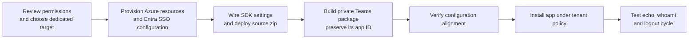

# Deployment runbook

[Overview](../README.md) | [Architecture](ARCHITECTURE.md) | [Configure](CONFIGURATION.md) | [Troubleshoot](TEST-RESULTS.md)

## Deployment at a glance



Deployment changes Azure/Entra resources and can incur charges. Packaging produces private deployment-specific artifacts, not public release assets. Alignment checks precede installation, but only the final live exchange proves SSO.

## Prerequisites and permissions

- Node.js **22 LTS**, npm, Azure CLI and **PowerShell 7.3+**. Use `pwsh`, not Windows PowerShell 5.1. No JavaScript build step is needed.
- An Azure public-cloud subscription in the same Entra tenant as the test users. The sample provisions a Linux B1 App Service plan, App Service, user-assigned managed identity and F0 Azure Bot. The App Service plan incurs charges.
- Azure permissions to create/configure these resources and assign the managed identity (for example Contributor plus Managed Identity Operator at the appropriate scope, or Owner).
- Entra permissions to create and update the dedicated application/service principal and federated credential. Tenant policy may restrict app registration; use an authorized application administrator when necessary. Azure subscription Owner alone does not confer Entra administrator permissions.
- Azure CLI's delegated Graph access must be permitted for the application operations. For consent scripts, `DelegatedPermissionGrant.ReadWrite.All` or equivalent authorized delegated access and a supported administrator role are required. Do not automatically grant broad Graph permissions to the sample.
- `get-signins.ps1` additionally requires access to Entra sign-in logs, appropriate reporting/security role, Graph `AuditLog.Read.All` access and any applicable Entra licensing. Diagnostics are not prerequisites for serving messages.
- Microsoft Teams with custom-app upload/installation allowed by tenant policy. Microsoft 365 Copilot visibility depends on the tenant's app-management policy, supported host and the user's entitlement.
- Azure resource providers `Microsoft.Web`, `Microsoft.ManagedIdentity` and `Microsoft.BotService` registered. Check/register them with an authorized subscription administrator before deploying.

## 1. Install and choose a dedicated target

```powershell
npm ci
npm test
az login --tenant '<tenant-id>'
az account set --subscription '<subscription-id>'
az account show --query '{subscription:id,tenant:tenantId}' -o json
```

Review the selected subscription/tenant locally. Do not save that output in the repository. Choose a unique lowercase `Name` (3-31 characters) and a dedicated resource group. Web app names are globally unique; the script adds a subscription-derived suffix but a collision is still possible.

```powershell
.\infra\deploy.ps1 `
  -SubscriptionId '<subscription-id>' `
  -TenantId '<tenant-id>' `
  -Name '<unique-sample-name>' `
  -ResourceGroup '<dedicated-resource-group>' `
  -Location 'swedencentral' `
  -ConnectionName 'SsoConnection' `
  -ScopeName 'agent_access'
```

The script refuses a subscription/tenant mismatch and requires explicit IDs. It:

1. Creates/reuses the dedicated resource group, identity and Linux Node 22 App Service.
2. Creates/reuses the SSO app by display name, configures v2 tokens, URI, exposed scope, authorized clients, delegated permissions, service principal and FIC trust.
3. Creates/configures the managed-identity Azure Bot, Teams channel and FIC OAuth connection.
4. Sets runtime handler/identity settings, HTTPS-only/TLS settings and startup command.
5. Deploys a zip containing only `src`, `package.json` and `package-lock.json`, using an ARM access token in the request header. App Service performs dependency installation.
6. Writes ignored `infra\.deploy-state.json` with resource IDs and names needed by local scripts.

Reruns update the sample's configuration; they are not a generic safe merge of unrelated app settings/permissions. Keep the same name, resource group, scope and tenant for updates. Avoid changing the scope on an existing app: disabling/removing an already enabled Entra scope requires a separate lifecycle procedure. The script is not transactional; if interrupted, inspect the resources before rerunning. Entra replication can require waiting and rerunning after app/scope creation.

The deployment account needs authenticated Kudu deployment access (including the relevant App Service publish action). Restricted SCM networking, tenant Graph consent or regional capacity policy may block deployment. Fix the specific permission/network constraint rather than switching on basic publishing credentials or disabling authentication.

## 2. Package and install the app

```powershell
.\scripts\build-package.ps1
.\scripts\verify-config.ps1
```

The package builder reads ignored deployment state, generates an ignored local `appPackage\teams-app-id.txt`, and creates:

```text
appPackage/build/manifest.json
appPackage/build/color.png
appPackage/build/outline.png
appPackage/build/sso-test-agent.zip
```

These are **deployment-specific private artifacts**. Do not commit or attach them to a public issue or release. Back up the Teams app ID in your approved private deployment storage if you need to rebuild updates from a fresh clone.

Before wider distribution, edit only the source template's public developer metadata and replace its `example.com` website/privacy/terms URLs with your own valid public URLs. Rebuild and validate the package in the Teams Developer Portal or your organization's approved validation process. Sample placeholders are not production store-listing metadata.

Upload the zip in Teams **Apps > Manage your apps > Upload an app > Upload a custom app**. If upload is unavailable, an administrator must enable the appropriate policy or upload it via **Teams apps > Manage apps** in the Teams admin center. Install/open the app's personal chat. In Copilot, find the enabled custom engine agent through the supported agent/app entry point; publishing a package does not override tenant policy or license requirements.

## 3. Verify serving and SSO

Read your endpoint from the local deployment state. Check `https://<app-service-name>.azurewebsites.net/health`: expect HTTP 200 with `{"status":"ok"}` after deployment/build completes. A POST of an unauthenticated message activity to `/api/messages` must be rejected; do not count a health response as proof of channel authentication.

`verify-config.ps1` reads live Entra, Bot, OAuth, runtime settings and the generated manifest. It exits with an error on a failed alignment check or missing package. It does not grant consent and does not prove a user's runtime exchange. Follow the [test matrix](TEST-RESULTS.md), including the logout/login cycle.

If needed, inspect diagnostics locally:

```powershell
.\scripts\get-logs.ps1 -Filter '\[sso-test\]' -Tail 100
.\scripts\get-signins.ps1 -Minutes 30
```

Service/dependency logs can contain personal or deployment information even though sample flow markers omit identities and tokens. Do not share raw logs, sign-in exports, OAuth cards, browser captures, screenshots or tokens. Redact locally before any approved sharing.

## 4. Optional administrator consent

Pre-authorized client acquisition and downstream delegated consent are different. If your tenant requires administrator consent, have an authorized administrator review the app's declared permissions first, then use **API permissions > Grant admin consent** or:

```powershell
.\scripts\grant-admin-consent.ps1
```

The script creates/updates tenant-wide `AllPrincipals` grants for the sample's Graph OIDC scopes and its configured own API scope. This affects all users of the dedicated app. It is not run automatically during deployment.

To repeat an isolated consent experiment, first preview:

```powershell
.\scripts\reset-consent.ps1 -WhatIf
.\scripts\reset-consent.ps1
```

Confirm each removal. This deletes delegated grants where the sample SSO service principal is the client, including user and tenant-wide grants. Never run against a shared app. Then send `logout` in the app and repeat `whoami`. Resetting these grants does not remove client pre-authorization, revoke all Entra sessions or bypass Conditional Access.

## 5. Updates and cleanup

Redeploy code with the same explicit deployment arguments. For manifest changes, keep the same local Teams app ID and increment the version:

```powershell
.\scripts\build-package.ps1 -Version '1.0.1'
.\scripts\verify-config.ps1
```

Re-upload/update the installed app. Preserve deployment state and the Teams ID privately; ignored files are intentionally absent in a new clone.

For cleanup, uninstall/remove the custom app through Teams administration. After independently confirming the exact dedicated resource group, delete that group in Azure to stop charges. Separately delete the dedicated Entra SSO app/service principal and associated grants/federated credentials: resource-group deletion does not delete Entra applications. Remove local generated state/packages only after confirming they are no longer needed. No cleanup command is executed by this sample automatically.
